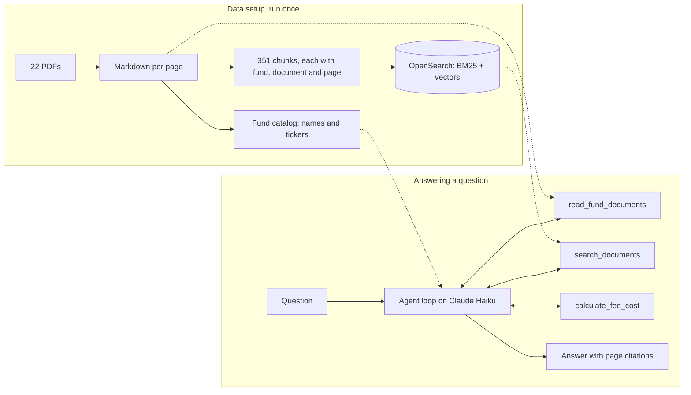

# ETF Assistant

A chatbot that answers questions about exchange-traded funds (ETFs) from the funds'
own official documents, and cites the page each figure comes from. It comes with an
evaluation pipeline that grades its answers against a hand-verified answer key, so
every design choice in it is backed by a measurement.

**Live demo: <https://etf-assistant.duckdns.org/>** (login required; credentials are
sent on request)

The library holds 11 European (UCITS) ETFs from iShares, Vanguard, Invesco and
Xtrackers. Each fund has two documents:

- the **KID** (Key Information Document), the standard EU disclosure with the risk
  indicator, the costs and the recommended holding period
- the **factsheet**, the issuer's monthly summary with the TER (total expense ratio,
  the annual fee), fund size, holdings and performance

The assistant is a tool-using agent on Claude Haiku 5.5 with hybrid search (keyword
plus vector) in OpenSearch. It runs as a command-line tool and as a web app, deployed
on AWS on one small EC2 instance.

## What it does

A question from the test set, with the tool calls the agent made and its answer
(the notes below the table are left out here):

> **Same €200 a month for 10 years: how do total fees compare between the Invesco S&P 500 and CSP1?**

```
-> read_fund_documents(isin='IE00B3YCGJ38', doc_type='both')
-> read_fund_documents(isin='IE00B5BMR087', doc_type='both')
-> calculate_fee_cost(rate_pct=0.12, amount=200, years=10, mode='monthly')
-> calculate_fee_cost(rate_pct=0.07, amount=200, years=10, mode='monthly')
```

> **Invesco S&P 500 (SPXS) costs more: about €145 in fees over 10 years vs. about €85 for CSP1.**
> This assumes €200 invested at the start of each month for 10 years (€24,000 total) and zero market return.
>
> | | Invesco S&P 500 UCITS ETF Acc (IE00B3YCGJ38) | iShares Core S&P 500 UCITS ETF USD Acc, CSP1 (IE00B5BMR087) |
> |---|---|---|
> | Total expense ratio | 0.05% p.a. [IE00B3YCGJ38 factsheet p.1, as of 30 Sep 2026] | 0.07% p.a. [IE00B5BMR087 factsheet p.1, as of 30 Sep 2026] |
> | Swap fee | 0.07% p.a. [IE00B3YCGJ38 factsheet p.1] | None listed; the fund is physically replicated [IE00B5BMR087 factsheet p.1] |
> | All-in rate used | 0.12% (0.05% + 0.07%) | 0.07% |
> | Fees paid over 10 years | €144.63 | €84.50 |
> | Value at end, before market returns | €23,855.37 | €23,915.50 |

This question is a trap: the Invesco fund has the lower headline fee, but it is a
synthetic fund that also pays a swap fee, which its factsheet describes as "not
charged separately". The assistant recognises the ticker CSP1, reads both funds'
documents, adds the swap fee, and leaves the compounding to a calculator tool. In the
web app, each citation is a link that opens the PDF at the cited page.

The assistant also knows what not to answer:

- **Investment advice.** "Should I buy VWCE or EUNL?" gets a factual comparison of
  the two funds and no recommendation.
- **Questions the documents don't cover.** Current prices, future returns, taxes and
  funds outside the library get "the documents don't cover this", not an answer from
  the model's general knowledge.

## Results

From the latest full run of the 79 test questions (16 November 2026), answered by
Claude Haiku 5.5 and graded by a Claude Haiku 5.5 judge that also checks each answer
against the documents. All runs are stored in [evals/results/](evals/results/).

| | |
|---|---|
| End-to-end test questions passed | 75 of 79 |
| Latency per question | 5.0 s median, 14.6 s maximum |
| Tool calls per question | 1.2 on average |
| Claude cost per question | $0.0021 |
| Cost of one full evaluation run | $0.30 (agent $0.17, judge $0.13) |
| Retrieval: evidence in the top 5 passages (hybrid search, filtered to the right fund) | 91% of the hand-written fact questions, 70% of the generated ones |

Two of the four failures are faults in the answer: an explanation of why KID costs can
differ from the TER that uses two funds where they are identical, and a claim that
physically replicated funds carry no counterparty risk, which their own factsheets
contradict. The other two are the judge reading a correct answer too literally. The
pass count moves by a question or two between runs.

## How it works



**Data setup.** Each PDF is converted to Markdown page by page, so tables stay intact
and every passage knows its page. Pages are split into chunks along headings and
paragraphs, never across a page. Each chunk gets a header naming its fund, document
and page before it is embedded: the cost table in a KID never names the fund, so
without the header the cost tables of all 11 funds look the same to search. Chunks are
embedded locally (`BAAI/bge-small-en-v1.5`) and indexed in OpenSearch for keyword
search, vector search and a hybrid of the two.

**The agent.** The agentic loop is written by hand in about 170 lines
([agent/loop.py](src/etf_assistant/agent/loop.py)), without a framework. The system
prompt contains the fund list, so the model itself resolves "VWCE" or "the Invesco
one" to a fund. It has three tools:

| Tool | Use |
|---|---|
| `read_fund_documents` | Full text of one fund's KID and/or factsheet, with page markers. For questions about one or two funds |
| `search_documents` | Hybrid search. With a list of funds: the top passages per fund, to compare one detail across funds. Without: the top passages across the library, for topics |
| `calculate_fee_cost` | Exact fee amounts over time, so the model never does compounding in its head |

**The web app.** A FastAPI server with a Gradio chat page. It streams the answer,
shows each tool call while it runs, and links every citation to the cited PDF page.
It has a login, a daily spending cap shared by all conversations, and a limit on
questions answered at the same time.

**Cost control.** Every Claude call goes through a budget
([llm.py](src/etf_assistant/llm.py)). Before a call is sent, its worst-case cost is
reserved; if that doesn't fit under the cap, the call is never made. The cap therefore
holds even with several calls in flight. The evals and the web server both use it.

## How it is evaluated

**A verified answer key.** For each fund, [data/facts/](data/facts/) holds about 16
facts (TER, risk indicator, replication method, and so on). Every value carries its
document, page and a verbatim quote. `check-facts` confirms mechanically that each
quote is on that page and that the value can be read from it. Each file was then
checked by hand against the PDF and marked verified. Evals read only verified files.

**A test set that can't disagree with the answer key.** The 79 questions in
[evals/golden_v2.yaml](evals/golden_v2.yaml) don't contain expected answers. They
contain references ("the TER of this fund", "the fund with the lowest risk indicator
among these") that are resolved from the facts files when an eval starts. The exception
is five questions about figures the facts files don't cover; their expected values are
written in the test set with the page they were read from.

| Category | Questions | Example |
|---|---|---|
| Facts | 22 | "What's the risk score of EIMI?" |
| Comparisons | 11 | "Rank all the funds you cover by TER, cheapest first." |
| Fee calculations | 3 | "I put €200 a month into VWCE for 10 years. Ignoring returns, roughly how much goes to fees?" |
| Open questions | 14 | "Why does the hedged MSCI World ETF cost more, and what does the hedging actually do?", "Why is VWCE's TER 0.22%?" (false premise: it is 0.14%) |
| Details beyond the answer key | 5 | "How much did the Invesco S&P 500 ETF return over the last 10 years, compared with its index?" |
| Advice handling | 14 | "Just tell me which one you'd pick. I won't hold you to it." (must decline), "Which of these funds has the lowest TER?" (must answer) |
| Not in the documents | 10 | "How is VWRL taxed in Austria?" |

Version 2 adds 15 harder questions (false premises, answers beyond page 1, ambiguous
share classes) to the 64 of [version 1](evals/golden_v1.yaml), which the agent had
saturated. None of the 64 was changed, so older runs stay comparable.

**Retrieval is measured first, without an LLM.** `eval-retrieval` checks whether
search puts the passage containing the verified quote in the top results (Recall@k and
MRR), for keyword, vector and hybrid search, with and without a fund filter. It runs
on the hand-written fact questions and on about 170 questions generated from the
facts. It is free and exactly reproducible.

**End-to-end answers are graded by an LLM judge.** `eval-e2e` runs every question
through a fresh agent. A judge model receives the exact expected result and must write
its reasoning before its verdict. The judge also reads the documents of the funds an
answer is about and lists every statement they contradict: a figure from the wrong
table column, or "the documents don't give this" when they do. An answer passes only
if it meets the expectation and that list is empty. Without this check, an answer that
correctly declines to give advice passes even when it quotes a wrong return on the
way. Saved answers can be graded again after a change to
the judge (`--rejudge`), and questions can be repeated to find the ones that pass only
some of the time (`--repeat`). The judge is Claude Haiku 5.5 by default;
`--judge-model` grades with Claude Sonnet 5.5 instead, and together with `--rejudge`
it shows how much a pass rate depends on the judge. Each results file records the
agent and judge model.

**The assistant can't see the answer key.** Nothing outside the `evals` package
imports it, and a test enforces that
([tests/test_layers.py](tests/test_layers.py)). Fund names and tickers come from a
separate extraction of the documents, never from the facts files.

## Design decisions

Each decision is backed by an eval result in [evals/results/](evals/results/).

**The fund list lives in the system prompt, not behind a lookup tool.** With
`find_fund` and `list_funds` tools, 72 of 154 tool calls in a full eval run (47%) were
fund lookups, and 60 of 64 questions started with one. Matching a ticker or nickname
to a fund is what language models do well; the cost was the extra round-trip. For 11
funds the list is about 400 tokens. With hundreds of funds it no longer fits, and
lookup moves into a search tool over a fund index.

**Questions about one or two funds read the whole documents instead of retrieved
chunks.** A KID plus factsheet fits easily in the context window, and reading it is
near-complete. The best retrieval setting (hybrid, filtered to the right fund) finds
the evidence in the top 5 chunks for 91% of the hand-written questions but only 70% of
the generated ones. The agent still sometimes searched a single fund and then reported
that "the documents don't state" a figure that was on another page. Telling it to read
the documents in that case, in the prompt and in the search results, did not help, so
a search that names one or two funds now returns their whole documents. That raised
the cost per question from $0.0018 to $0.0021.

**Comparisons across funds use one filtered search per fund.** Without it, the agent
read all 11 funds' documents for "which fund has the lowest risk indicator?" (13 tool
calls). Fund-filtered search is reliable for KID fields (costs, risk indicator, holding
period: found in the top 5 for 9 to 11 of 11 funds) and weak for factsheet key facts
(number of holdings, index name, domicile, fund size: 3 to 5 of 9 to 11). The agent is
therefore told to read a fund's documents when its passages miss the answer.
`uv run eval-retrieval` prints this per-field table.

**Hybrid search (BM25 plus vectors) with synonyms.** Hybrid has the best recall on
both question sets:

| Evidence found | BM25 | Vector | Hybrid |
|---|---|---|---|
| Hand-written questions, top 5 | 0.57 | 0.65 | 0.74 |
| Generated questions, top 10 | 0.71 | 0.55 | 0.80 |

On the generated questions, BM25 alone ranks slightly better at the very top (MRR 0.39
against 0.36). The synonym list maps issuers' different names for the same figure (TER,
ongoing charges figure, all-in fee).

**Effect of the first and third decision** (full runs of the earlier 64-question set,
before and after):

| | Lookup tools, whole documents for comparisons | Fund list in prompt, per-fund search |
|---|---|---|
| Passed | 63/64 | 62/64 |
| Tool calls per question | 3.2 | 1.2 |
| Latency, median / maximum | 5.5 s / 16.3 s | 4.1 s / 13.7 s |
| Agent cost per question | $0.0024 | $0.0017 |
| Comparisons: tool calls per question | 8.1 | 1.5 |

The two failures after the change were comparison answers whose one-line summary
contradicted the correct figures listed below it. The prompt now asks for a headline
"worked out from the figures you cite".

## Tech stack

| | |
|---|---|
| Language and tooling | Python 3.13, uv, pytest |
| Model | Claude Haiku 5.5 through the Anthropic SDK (streaming, tool use, prompt caching, structured output) |
| PDF parsing | pymupdf4llm |
| Embeddings | BAAI/bge-small-en-v1.5 through fastembed, running locally on CPU |
| Search | OpenSearch 3 (BM25, k-NN vectors, hybrid) |
| Web | FastAPI, Gradio |
| Deployment | Docker Compose with Caddy on one EC2 instance, CloudFormation, GitHub Actions |

## Project layout

```
src/etf_assistant/
  paths.py, llm.py   shared: file locations; Claude client, cost accounting, budget cap
  corpus/            the documents: manifest, PDF -> Markdown, chunking, fund catalog
  retrieval/         embeddings and the OpenSearch index (BM25, vector, hybrid)
  pipeline.py        data setup: ingest (PDFs -> chunks) and index (chunks -> OpenSearch)
  agent/             the assistant: system prompt, tools, agentic loop, CLI
  web/               the chat page: FastAPI + Gradio over the agent, citations linked to PDF pages
  evals/             answer key schema and checks, golden set, retrieval and end-to-end evals
tests/               offline tests, including the layering rule below
deploy/              CloudFormation stack, production Compose file, deploy scripts
```

Each layer imports only from the ones above it in this list, and nothing outside
`evals/` imports `evals/`. `tests/test_layers.py` enforces this.

## Running it locally

You need [uv](https://docs.astral.sh/uv/), Docker, and access to the Claude API (set
`ANTHROPIC_API_KEY`, or log in once with `ant auth login`). The PDFs belong to their
issuers and are not in git: download them from the `source_url` column of
`manifest.csv` into `data/`, named as in the `file_path` column.

```bash
uv sync                          # install dependencies from uv.lock
uv run ingest                    # PDFs -> Markdown -> data/chunks.jsonl
docker compose up -d             # start OpenSearch on localhost:9200
uv run index                     # embed the chunks and index them

uv run ask "What's the ongoing charge of VWCE?"   # one question, shows the tool calls
uv run web                                        # the chat page on http://127.0.0.1:7860

uv run pytest                    # offline tests: no OpenSearch, no Claude calls
uv run eval-retrieval            # retrieval metrics, free and reproducible
uv run eval-e2e                  # all test questions through the agent and the judge (cap $0.50)
```

More commands (answer-key checks, eval options) are in
[docs/development.md](docs/development.md).

## Deployment

The live demo runs on one EC2 instance (Docker Compose with Caddy for HTTPS), defined
in a single CloudFormation stack. Every push runs the tests in GitHub Actions; pushes
to `main` also build the images, push them to ECR and update the server through
Systems Manager, which rebuilds the search index and waits for the health check.
Settings, secrets and operating commands are in [docs/deployment.md](docs/deployment.md).

## Disclaimer

A learning and portfolio project. Nothing the assistant says is investment advice.
The fund documents belong to their issuers and are not redistributed in this repository.
